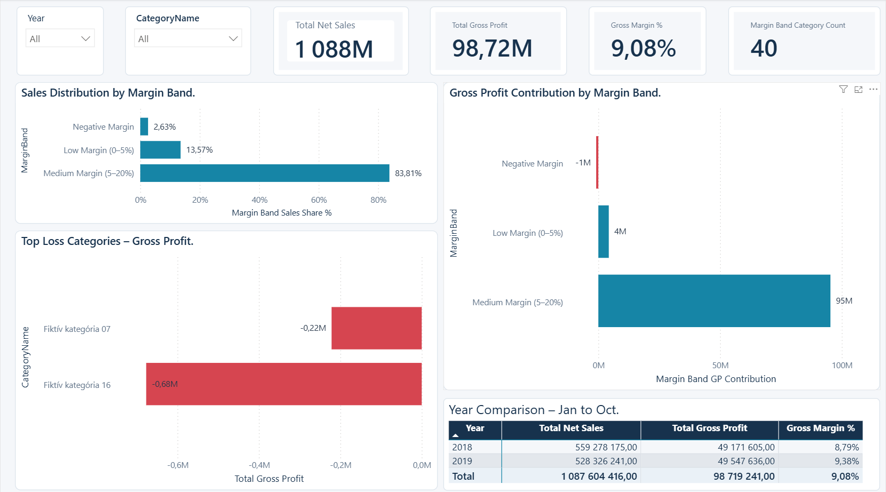
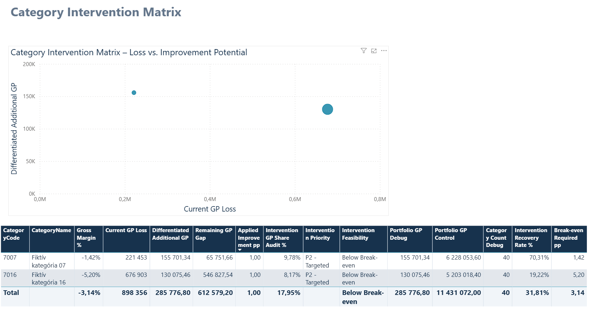
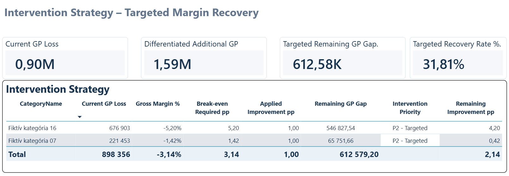
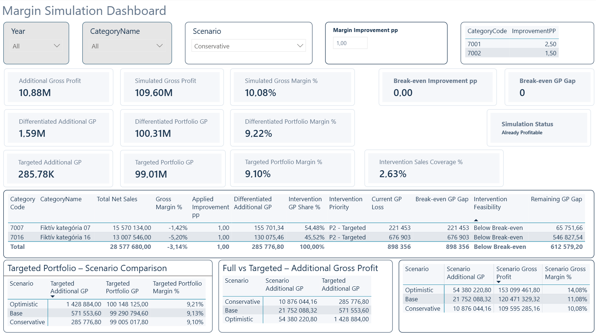
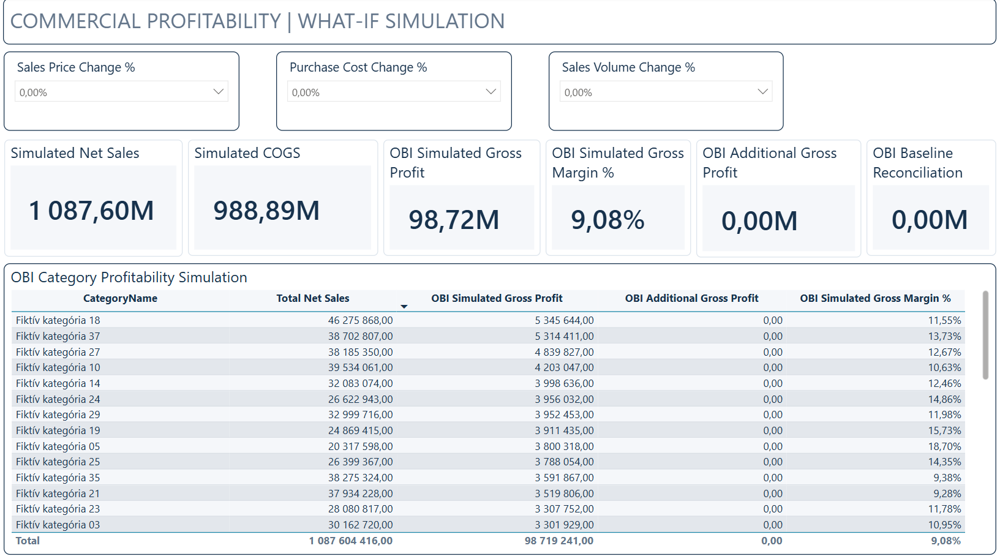
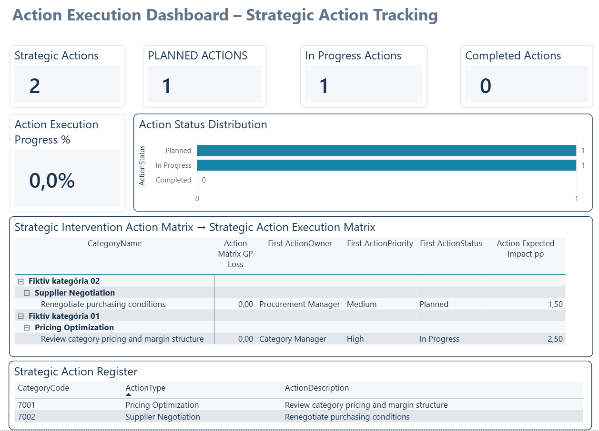
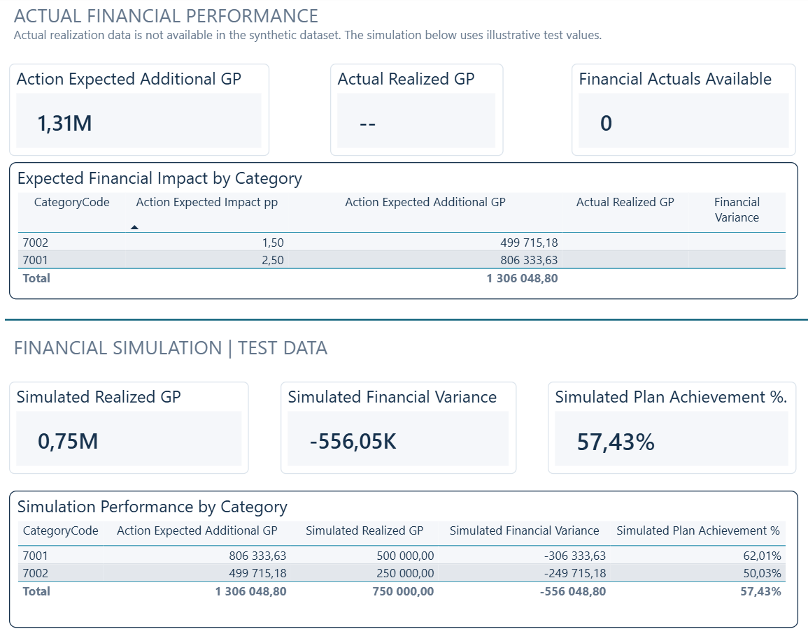

# Data Compass | Power BI — Sales & Purchase Analytics

**A synthetic-data business intelligence portfolio project for commercial profitability, category performance, and strategic decision support.**

> **Portfolio demonstration only.** All source data is synthetic. Results, category names, supplier names, intervention plans, and simulated financial outcomes do not represent actual company performance.

## Project overview

This Power BI project demonstrates an end-to-end analytical workflow for sales and purchasing data: source preparation, Power Query transformations, dimensional modelling, DAX measures, financial reconciliation, interactive reporting, and scenario-based decision support.

The reporting experience connects historical performance analysis with potential management actions, including margin improvement, pricing optimisation, supplier negotiations, and execution tracking.

## Business objectives

- Monitor revenue, cost of goods sold (COGS), gross profit, and gross margin.
- Compare category profitability and identify loss-making categories.
- Assess targeted margin-recovery opportunities and break-even requirements.
- Test commercial scenarios through interactive what-if parameters.
- Track strategic actions and distinguish expected, simulated, and actual financial outcomes.
- Validate key financial measures and category mappings.

## Financial baseline

Reference totals for the supplied synthetic dataset, with report filters cleared:

| Metric | Reference value |
|---|---:|
| Net sales | HUF 1,087,604,416 |
| COGS | HUF 988,885,175 |
| Gross profit | HUF 98,719,241 |
| Gross margin | 9.08% |
| Net purchases | HUF 1,286,211,333 |
| Sales quantity | 117,311 units |
| Gross profit reconciliation | HUF 0 |

**Note:** Report visuals may display rounded values (M/K). Individual intervention and scenario metrics depend on the current filter and parameter context.

## Dashboard gallery

The seven selected portfolio pages illustrate the core analytical and management capabilities. Images are linked using repository-relative paths.

### 1. Category Performance Overview

Executive view of net sales, gross profit, gross margin, sales distribution by margin band, loss-making categories, and year-on-year comparison (January–October).



### 2. Category Intervention Matrix

A visual comparison of current gross profit loss and differentiated improvement potential, supported by a category-level intervention matrix.



### 3. Intervention Strategy

Targeted margin-recovery analysis, including current gross profit loss, additional profit potential, remaining gap, and recovery rate.



### 4. Margin Simulation Dashboard

Scenario comparison across conservative, base, and optimistic assumptions, with category-level improvement plans and targeted versus full-portfolio outcomes.



### 5. OBI What-if Simulation

Interactive sensitivity analysis for changes in selling prices, purchase costs, and sales volume, with recalculated sales, COGS, profit, and margin.



### 6. Action Execution Dashboard

Strategic action monitoring with status distribution, ownership, priorities, and an action register. The example dataset includes two illustrative actions.



### 7. Financial Realization

Separate views of expected financial impact and **illustrative simulation test data**. Actual financial realization is intentionally blank because the synthetic source contains no recorded actual realization values.



## Technical approach

| Layer | Implementation |
|---|---|
| Data source | Synthetic Excel workbook, covering 2018 and 2019 sales and purchasing records |
| Data preparation | Power Query staging, cleaning, transformation, and audit queries |
| Analytical model | Sales and purchase fact tables connected to date and category dimensions |
| Calculations | DAX financial measures, margin bands, reconciliations, interventions, and scenario calculations |
| Interactivity | Slicers, category drill-down, what-if parameters, and scenario selection |
| Validation | Financial reconciliation, category coverage checks, and action-plan consistency tests |
| Presentation | Power BI Desktop with a consistent Data Compass visual design |

Selected model objects include `fact_sales`, `fact_purchase`, `dim_date`, `dim_category`, `dim_category_action_plan`, and intervention/scenario support tables. The report also contains technical validation pages, which are not part of the seven-image portfolio gallery.

## Key analytical capabilities

**Profitability analysis:** Measure category contribution, detect negative-margin categories, and compare financial performance across periods.

**Targeted intervention modelling:** Estimate the impact of differentiated percentage-point improvements and measure remaining recovery gaps. These are illustrative estimates, not guaranteed savings.

**What-if simulation:** Change sales prices, purchasing costs, and sales volume independently to examine directional effects on financial outcomes.

**Execution and realization:** Connect proposed commercial actions to owners and statuses; keep expected impacts separate from simulated realization and unavailable actual results.

## Files and repository layout

The expected published structure is:

```text
.
├── README.md
├── Project_2_PORTFOLIO_FINAL.pbix
├── Project_2_Synthetic_Data_GITHUB.xlsx
├── 05_PORTFOLIO_SCREENSHOTS/
    ├── 01_Category_Performance_Overview.png
    ├── 02_Intervention_Matrix.png
    ├── 03_Intervention_Strategy.png
    ├── 04_Margin_Simulation.png
    ├── 05_OBI_What_If.png
    ├── 06_Action_Execution.png
    └── 07_Financial_Realization.png
```

The screenshot names and relative paths must match the actual files uploaded to the repository. The original working PBIP folders, backup files, and confidential source workbooks are **not** intended for publication.

## How to open and refresh the report

1. Download `Project_2_PORTFOLIO_FINAL.pbix` and `Project_2_Synthetic_Data_GITHUB.xlsx` to your computer.
2. Open the PBIX in **Microsoft Power BI Desktop**.
3. Go to **Home → Transform data → Edit parameters**.
4. Set `pSourceFilePath` to the **full local path** of your downloaded `Project_2_Synthetic_Data_GITHUB.xlsx` file. Do not include quotation marks around the path.
5. If prompted, configure the local Excel file's data-source permissions.
6. With filters cleared and what-if parameters at their baseline values, compare the results with the **Financial baseline** table above.

For more detailed instructions, see `README_Project_2.txt`.

## Data quality and validation

The model includes checks for unmatched sales/purchase categories, financial reconciliation, and action-plan consistency. The reviewed baseline returned **zero gross profit reconciliation difference**. Technical audit pages support development and verification but are not all included in the public screenshot selection.

## Data provenance and limitations

- All published input data is **synthetic** and intended solely for demonstration.
- The 2018–2019 period is historical sample context, not a current business forecast.
- Category and supplier identities are fictitious.
- Planned interventions, expected impacts, and simulated results are hypothetical examples.
- **Actual financial realization data is unavailable** in the synthetic dataset. Blank actuals must not be interpreted as zero realized performance.
- The simulated realized gross profit and plan-achievement metrics use separate illustrative test values and are **not evidence of achieved results**.
- Any implementation in a real organisation would require validated operational data, business rules, access controls, and financial governance.

## Business value

The project illustrates how a unified commercial analytics model can help management move from descriptive reporting toward structured intervention prioritisation, scenario assessment, and measurable execution tracking.

**Tools:** Microsoft Power BI Desktop · Power Query (M) · DAX · Excel

---

*Data Compass — data-driven commercial strategy and decision support.*
